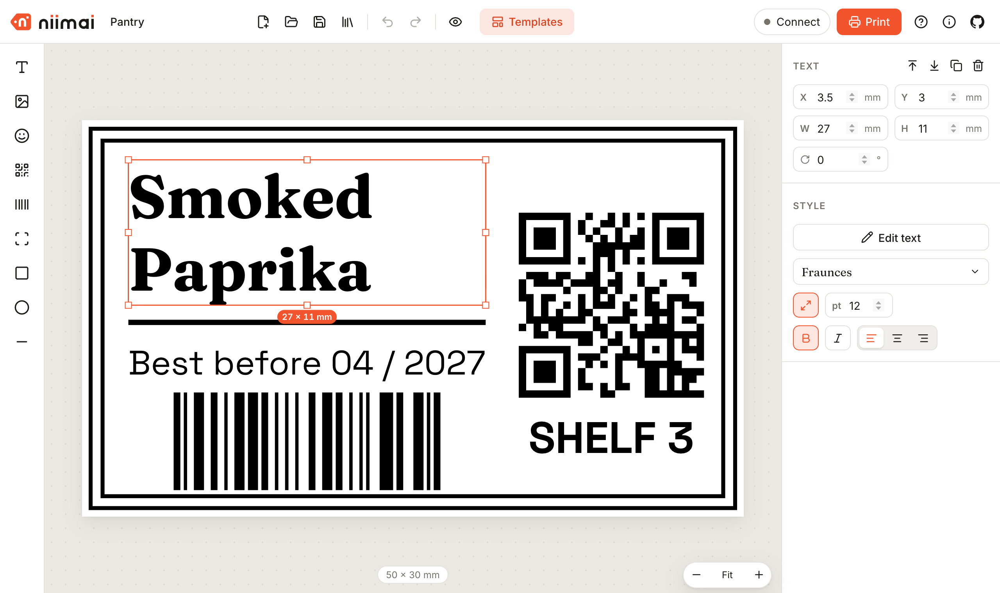
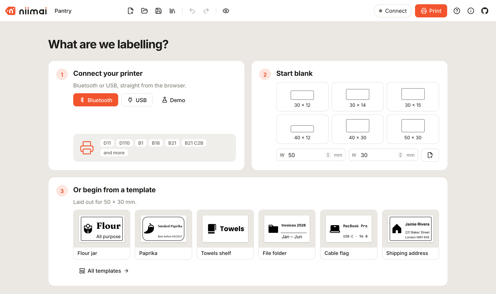
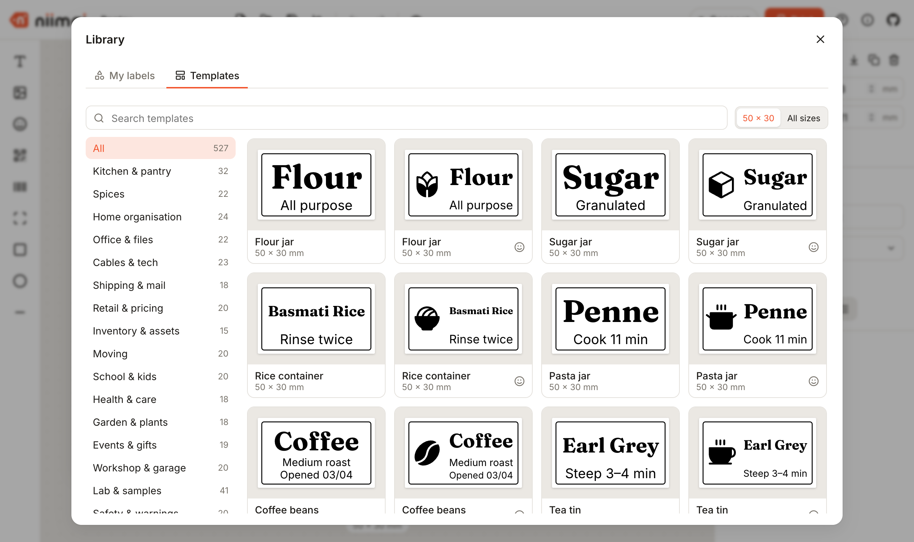

<h1 align="center">
  <picture>
    <source media="(prefers-color-scheme: dark)" srcset="docs/logo-dark.svg" />
    
  </picture>
</h1>

<p align="center">
  Design and print labels on NIIMBOT and other Bluetooth thermal printers, right in your browser.<br />
  <a href="https://niimai.app/"><strong>Open the app →</strong></a>
</p>

<p align="center">
  
</p>

## Features

- **A start screen** that gets you printing fast: connect, start blank, or pick a template sized for your roll.
- **Connects directly** to NIIMBOT printers over Bluetooth or USB. No app install, no account. Warns when the design does not match the loaded roll, and prints a ruler test for fine-tuning the print position.
- **Text, images, QR codes, barcodes, frames and shapes**, with snapping, rotation and undo. Text is edited right on the label, frames come in 11 styles, from double lines to tickets and scallops, and SVG artwork can be imported or pasted.
- **Over 6,800 templates** across 22 categories, from pantry jars, cable flags and perfume decants to travel toiletries, lab samples and electronics drawers, most with icon versions, laid out for every common roll size.
- **Every Google Font**, grouped by category and previewed in the picker.
- **1,500 icons** from Phosphor in regular, bold and fill weights, chosen for crisp thermal printing.
- **What you see is what prints.** A 1-bit preview shows every dot, photos are dithered for thermal paper, the edges your printhead cannot reach are shaded, and details finer than a printer dot are flagged.
- **Works with other Bluetooth thermal printers too.** Small 58 mm ESC/POS and cat printers connect the same way and print on continuous paper, with the label length set right in the editor.
- **Recognises 60+ NIIMBOT rolls** from the barcode on their RFID tag, setting the label size and paper type and showing how many labels are left ([list](docs/known-rolls.md)).
- **Browser printing** of the label as a vector document at its exact size.
- **Local-first.** Labels are kept on your device, and can be saved to and opened from `.niimai` files.
- **Keyboard shortcuts** for everything you do often.

<table>
  <tr>
    <td></td>
    <td></td>
  </tr>
</table>

## Supported printers

### NIIMBOT

niimai is built around NIIMBOT printers. It uses [niimbluelib](https://github.com/MultiMote/niimbluelib), which recognises most current models (D11, D110, B1, B18, B21 and more), and adds support verified on hardware for the B21 C2B on early firmware. For models the library does not recognise yet, choose the closest printer type in the printer settings.

### Other Bluetooth thermal printers

niimai also prints on small Bluetooth thermal printers that use 58 mm continuous paper, with a 48 mm print width:

- **ESC/POS mini printers**, such as the MP583 (sold as YAEN MPT-II), PT-210 and MTP-II
- **Cat printers**, such as the GB01, GB02, GB03, MX05, MX06 and MX10

Connect them with the same Bluetooth button. See the [known models and how well each is supported](docs/thermal-printers.md).

### Browsers

Printing needs a browser with Web Bluetooth or Web Serial: Chrome or Edge on desktop, or Chrome on Android, where niimai has a phone-sized layout. iPhone and iPad browsers cannot reach printers; the Bluefy browser adds Bluetooth there. Designing labels works in any modern browser.

## Development

```bash
npm install
npm run dev
```

The dev server runs at http://localhost:5197.

| Command | What it does |
| --- | --- |
| `npm test` | Runs the test suite |
| `npm run build` | Builds the static site into `dist/` |
| `npm run fonts` | Refreshes the Google Fonts list |
| `npm run icons` | Rebuilds the icon library from Phosphor |
| `npm run screenshot` | Regenerates the README screenshot and social image (needs Chrome) |

Pushes to `main` deploy to GitHub Pages through the included workflow.

## Feedback

Found a bug or have an idea? [Open an issue](https://github.com/theanam/niimai/issues). For anything else, write to [anam.ahmed.a@gmail.com](mailto:anam.ahmed.a@gmail.com).

## Credits

- [niimbluelib](https://github.com/MultiMote/niimbluelib) by MultiMote, for the NIIMBOT printer protocol
- [rbaron/catprinter](https://github.com/rbaron/catprinter) and [NaitLee/Cat-Printer](https://github.com/NaitLee/Cat-Printer), for the cat printer protocol
- [bwip-js](https://github.com/metafloor/bwip-js), for barcodes and QR codes
- [Fontsource](https://fontsource.org), for the Google Fonts catalogue
- [Phosphor Icons](https://phosphoricons.com) (MIT), for the icon library

niimai is an independent project and is not affiliated with NIIMBOT.

## License

[MIT](LICENSE)
