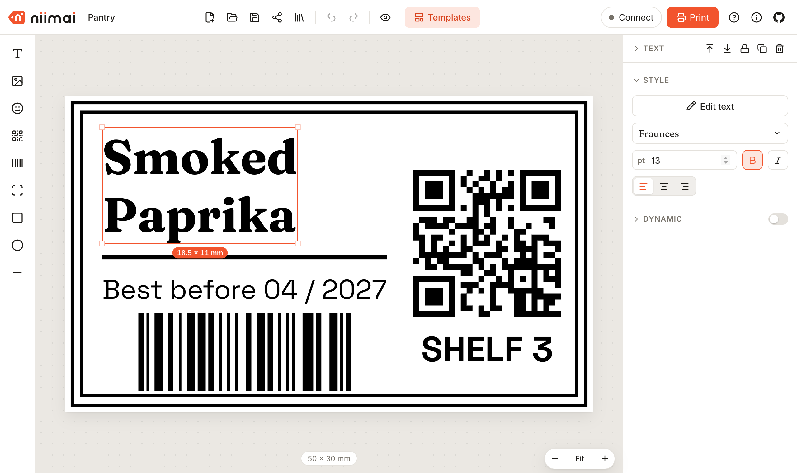
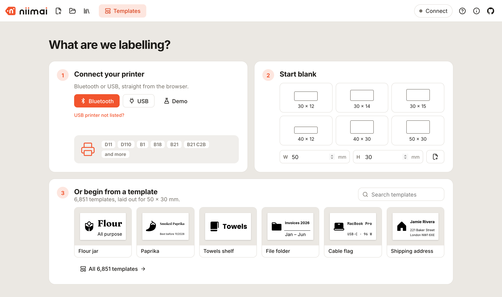
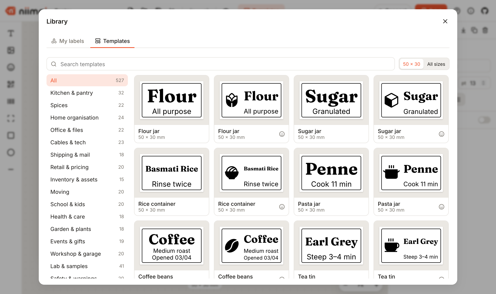

<h1 align="center">
  <picture>
    <source media="(prefers-color-scheme: dark)" srcset="docs/logo-dark.svg" />
    
  </picture>
</h1>

<p align="center">
  Design and print labels on NIIMBOT and other Bluetooth thermal printers, right in your browser.<br />
  <a href="https://niimai.app/"><strong>Open the app →</strong></a>
</p>

<p align="center">
  
</p>

## Features

- **A start screen** that gets you printing fast: connect, start blank, or pick a template sized for your roll.
- **Connects directly** to NIIMBOT printers over Bluetooth or USB. No app install, no account. Warns when the design does not match the loaded roll, and prints a ruler test for fine-tuning the print position.
- **Text, images, QR codes, barcodes, frames and shapes**, with snapping, rotation, undo, zoom and live sizes. Select several to align, space, group or lock them. Text is edited right on the label, frames come in 11 styles, from double lines to tickets and scallops, and SVG artwork can be imported or pasted.
- **Over 6,800 templates** across 22 categories, from pantry jars, cable flags and perfume decants to travel toiletries, lab samples and electronics drawers, most with icon versions, laid out for every common roll size. Dates fill in with today's, and only warning labels carry a border, so a label that sits a little off on the roll still looks right.
- **Batches from a sheet.** Mark text, QR codes or barcodes as dynamic and fill `{{fields}}` from the columns of a CSV or Excel file, one label per row, for shipping labels, name badges or price tags. Serial numbers count up on their own, and today's date or a best-before date fill in when you print.
- **Every Google Font**, grouped by category and previewed in the picker.
- **1,500 icons** from Phosphor in regular, bold and fill weights, chosen for crisp thermal printing.
- **What you see is what prints.** A 1-bit preview shows every dot, photos are dithered for thermal paper, the edges your printhead cannot reach are shaded, and details finer than a printer dot are flagged.
- **Works with other Bluetooth thermal printers too.** TSPL label printers up to 80 mm wide and Marklife label printers print on labels with gaps. Small 58 mm ESC/POS and cat printers print on continuous paper or sticker rolls, with the label length set right in the editor and templates made for long formats, from to-do lists to daily plans. Save each paper you use, sticker rolls and all, and load it again in one step.
- **Keep your printer settings.** Save every printer's settings and your saved papers to a file, and load them on another device or browser.
- **Recognises 60+ NIIMBOT rolls** from the barcode on their RFID tag, setting the label size and paper type and showing how many labels are left ([list](docs/known-rolls.md)).
- **Browser printing** of the label as a vector document at its exact size.
- **Local-first.** Labels are kept on your device, and can be saved to and opened from `.niimai` files. Recent prints wait in the library to print again.
- **Share as a link.** The label travels inside the link, so nothing is uploaded.
- **Works offline** once loaded, and installs like an app.
- **Keyboard shortcuts** for everything you do often.

<table>
  <tr>
    <td></td>
    <td></td>
  </tr>
</table>

## Supported printers

### NIIMBOT

niimai is built around NIIMBOT printers. It uses [niimbluelib](https://github.com/MultiMote/niimbluelib), which recognises most current models (D11, D110, B1, B18, B21 and more), and adds support verified on hardware for the B21 C2B on early firmware. For models the library does not recognise yet, choose the closest printer type in the printer settings.

### Other Bluetooth thermal printers

| Type | Paper | Print width | Models |
|---|---|---|---|
| **TSPL label printers** | Labels with gaps, black mark or continuous | Up to 80 mm | QR380A (sold as CC390), Gprinter GP-M322 |
| **ESC/POS receipt printers** | 58 or 80 mm, continuous or stickers | 48 or 72 mm | MP583 (sold as YAEN MPT-II), Xprinter XP-58IIL, PT-210, RPP02, MTP-II and more |
| **Cat printers** | 58 mm continuous or stickers | 48 mm | GB01, GB02, GB03, MX05, MX06, MX10 and more |
| **Marklife label printers** | 12–15 mm tape, or stickers up to 50 mm | 12 or 48 mm | P12, P15, P11, P50 |

Connect them with the same Bluetooth button. Label printers work like a NIIMBOT: pick the roll size and paper type, and the printer finds each label's edge. See the [known models and how well each is supported](docs/thermal-printers.md).

### Browsers

Printing needs a browser with Web Bluetooth, Web Serial or WebUSB: Chrome or Edge on desktop, or Chrome on Android, where niimai has a phone-sized layout. iPhone and iPad browsers cannot reach printers; the Bluefy browser adds Bluetooth there. Designing labels works in any modern browser.

## libniimai: the printer library

[](https://www.npmjs.com/package/libniimai)
[](https://www.npmjs.com/package/libniimai)
[](https://www.npmjs.com/package/libniimai)
[](https://bundlephobia.com/package/libniimai)
[](LICENSE)

Everything niimai does to reach a printer ships on its own as **libniimai**: connect over Web Bluetooth, Web Serial or WebUSB, detect the printer family, and print any canvas on NIIMBOT, TSPL, ESC/POS, cat and Marklife printers from your own web page.

```bash
npm i libniimai
```

```ts
import { createPrinter } from 'libniimai';

const printer = createPrinter();
await printer.connect('bluetooth'); // from a click
await printer.print(canvas, { density: 3, copies: 1 });
```

See the [library README](packages/libniimai/README.md) for the API and printer details.

## Development

```bash
npm install
npm run dev
```

The dev server runs at http://localhost:5197.

| Command | What it does |
| --- | --- |
| `npm test` | Runs the app and library tests |
| `npm run build` | Builds the static site into `dist/` |
| `npm run lib:build` | Builds libniimai into `packages/libniimai/dist/` |
| `npm run fonts` | Refreshes the Google Fonts list |
| `npm run icons` | Rebuilds the icon library from Phosphor |
| `npm run screenshot` | Regenerates the README screenshot and social image (needs Chrome) |

The printer code lives in `packages/libniimai`, an npm workspace the app builds from directly. Pushes to `main` deploy to GitHub Pages; a `libniimai-v*` tag publishes the library to npm.

## Feedback

Found a bug or have an idea? [Open an issue](https://github.com/theanam/niimai/issues). For anything else, write to [anam.ahmed.a@gmail.com](mailto:anam.ahmed.a@gmail.com).

## Credits

- [niimbluelib](https://github.com/MultiMote/niimbluelib) by MultiMote, for the NIIMBOT printer protocol
- [rbaron/catprinter](https://github.com/rbaron/catprinter) and [NaitLee/Cat-Printer](https://github.com/NaitLee/Cat-Printer), for the cat printer protocol
- TSC's TSPL programming manual, for the label printer language
- [tomLadder/thermoprint](https://github.com/tomLadder/thermoprint) and [thermal-label/marklife](https://github.com/thermal-label/marklife), for the Marklife protocol notes
- [bwip-js](https://github.com/metafloor/bwip-js), for barcodes and QR codes
- [Fontsource](https://fontsource.org), for the Google Fonts catalogue
- [Phosphor Icons](https://phosphoricons.com) (MIT), for the icon library

niimai is an independent project and is not affiliated with NIIMBOT.

## License

[MIT](LICENSE)
